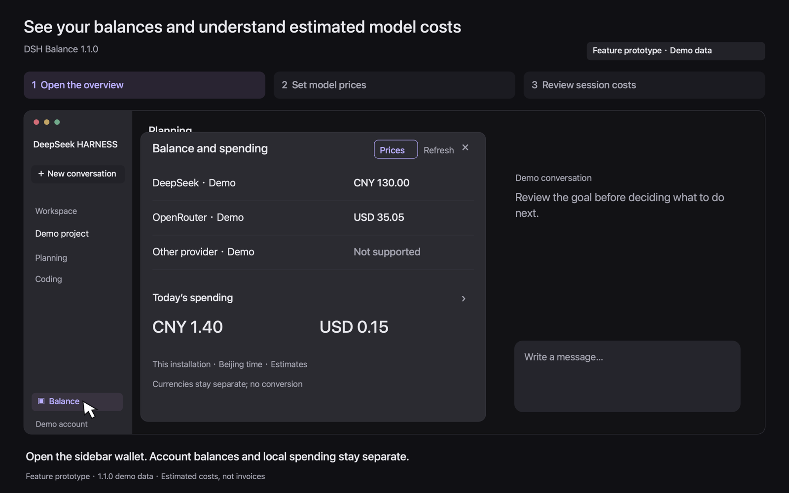
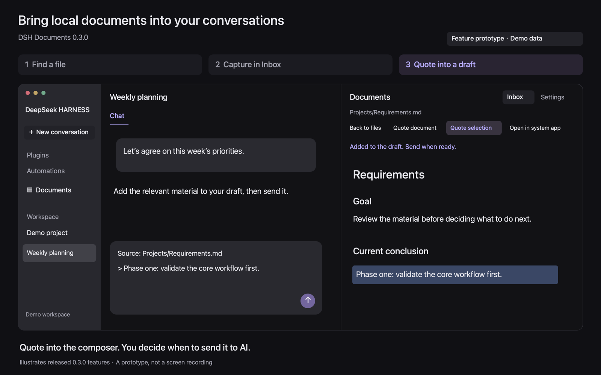

# deepseek-harness-plugin

[中文](README.md) | English

A collection of independently developed community plugins for DeepSeek Harness. Each plugin has its own directory for source, dependencies, tests and documentation, and is released as a separate installable package.

## Development and maintenance

These plugins grew out of my own needs and are primarily built for personal use. They have not undergone comprehensive compatibility testing across different environments. Please refer to each plugin's documentation for its verified scope.

Questions and suggestions are welcome in [Issues](https://github.com/pipilu123566/deepseek-harness-plugin/issues). If a requested feature would also be useful to me, I will actively work on it; other requests are unlikely to be implemented. You are welcome to fork the repository and develop the features you need.

I am a programming beginner, and all these plugins were developed using AI. Feedback on shortcomings in the code or design is welcome.

## Plugins

| Plugin | Purpose | Published version and installation | Compatible host |
| --- | --- | --- | --- |
| [DSH Balance](dsh-balance/README.en.md) | View balances, daily and session costs, and configure model prices | [1.1.0 Release](https://github.com/pipilu123566/deepseek-harness-plugin/releases/tag/%40pipilu123566%2Fdsh-balance%401.1.0) | DeepSeek Harness 0.2.1-rc.5 |
| [DSH Remote Desktop](dsh-remote-desktop/README.en.md) | Control a Mac from a mobile browser, with keyboard/mouse input and pinch zoom | [0.4.1 preview](https://github.com/pipilu123566/deepseek-harness-plugin/releases/tag/%40pipilu%2Fdsh-remote-desktop%400.4.1) | DeepSeek Harness 0.2.1-rc.5 |
| [DSH Documents](dsh-documents/README.en.md) | Browse local files, append to Inbox, live preview, autosave and quote into drafts | [0.3.0 Release](https://github.com/pipilu123566/deepseek-harness-plugin/releases/tag/%40pipilu123566%2Fdsh-documents%400.3.0) | DeepSeek Harness 0.2.1-rc.5 |

See each plugin's documentation for its features, installation steps and support scope.

### See the workflows

These previews include actual plugin UI and feature prototypes; see the plugin homepages for source labels. Select a preview for the complete animation, static steps and support scope on the plugin’s home page.

| Balance · 1.1.0 | Remote Desktop · 0.4.1 preview | Documents · 0.3.0 |
| --- | --- | --- |
| [](dsh-balance/README.en.md#see-the-workflow) | [](dsh-remote-desktop/README.en.md#see-the-workflow) | [](dsh-documents/README.en.md#see-the-workflow) |
| Inspect balances, set model prices and review session cost estimates | Connect to a Mac, zoom and pan, type and disconnect | Find documents, append to Inbox and quote into a conversation |

The repository root is not a plugin. Follow the selected plugin's documentation and download its Release `.tgz`; do not pass the collection's root URL directly to the plugin installer. Support claims are defined by each published version's README and validation record.

## Structure and development

```text
deepseek-harness-plugin/
├── README.md
├── README.en.md
├── CONTRIBUTING.md
├── LICENSE
├── dsh-balance/
└── dsh-documents/
    ├── package.json
    ├── pnpm-lock.yaml
    ├── README.md
    ├── README.en.md
    ├── LICENSE
    └── Source, tests and documentation
```

Add future plugins as separate top-level directories. Each keeps its own version, dependencies, lockfile, tests and installation instructions. Develop and build inside the target plugin directory; installing every plugin's dependencies is unnecessary. See the [contribution and release conventions](CONTRIBUTING.md).

For problems, include the plugin name, plugin version and host version in [Issues](https://github.com/pipilu123566/deepseek-harness-plugin/issues). DSH Balance continues to use its existing [official community showcase thread](https://github.com/deepseek-ai/deepseek-harness/discussions/11526).

## License

Project-owned code is licensed under [MIT](LICENSE). Each plugin package includes its license; third-party dependencies retain their own licenses.
