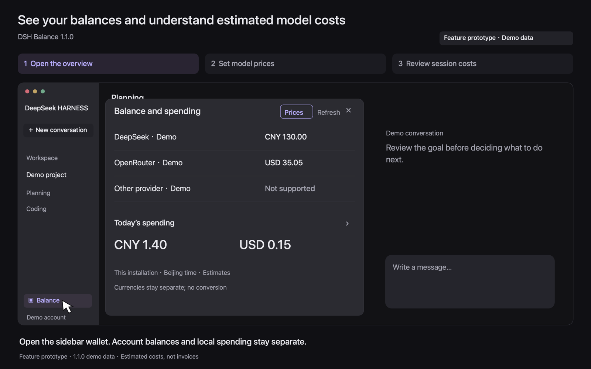
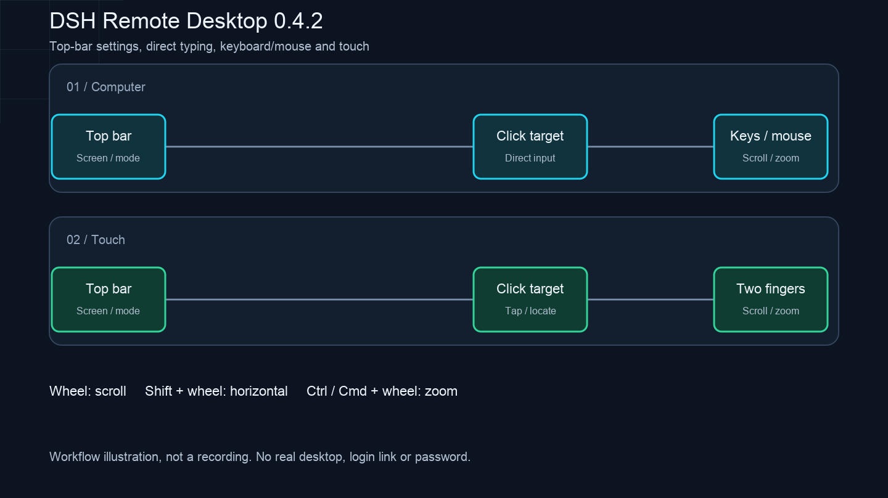
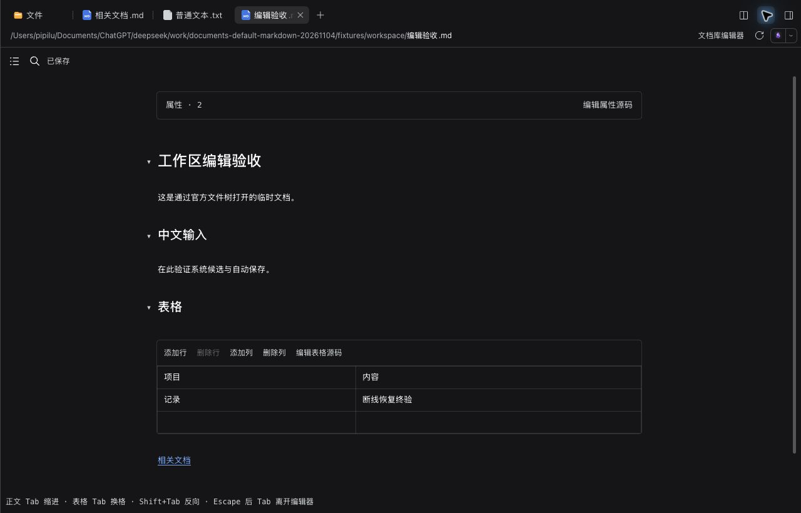

# deepseek-harness-plugin

[中文](README.md) | English

Add balance and spending insights, Mac remote control, and a local document library to DeepSeek Harness. Choose a plugin, see it in action, and follow its installation guide.

## Plugins

### Balances and spending · DSH Balance 1.1.0

See what remains in your accounts, how much you spent today, and which sessions account for the costs. Inspect model or session breakdowns in the sidebar and set your own model prices.

A 1.1.0 feature prototype with demonstration amounts and prices. [Demo and installation](dsh-balance/README.en.md) · [Download 1.1.0](https://github.com/pipilu123566/deepseek-harness-plugin/releases/tag/%40pipilu123566%2Fdsh-balance%401.1.0)

### Remote Desktop · 0.4.2 preview

View and control a Mac from a computer, phone or iPad browser, with keyboard/mouse input and touch zoom. The controlled computer requires an Apple Silicon Mac running macOS 13 or later; see the plugin guide for connection requirements and verified coverage.

A 0.4.2 workflow illustration, not a screen recording. [Demo and installation](dsh-remote-desktop/README.en.md) · [Download preview](https://github.com/pipilu123566/deepseek-harness-plugin/releases/tag/%40pipilu%2Fdsh-remote-desktop%400.4.2)

### Documents · 0.9.0

Browse and edit documents alongside conversations, capture notes into Inbox and quote selections for AI. Optionally reuse the official file tree to edit Markdown with live preview, outline navigation, collapsed properties, tables and code blocks. Edits save to the original files.

Actual 0.9.0 Web interface using temporary demo documents. [Demo and installation](dsh-documents/README.en.md) · [Download 0.9.0](https://github.com/pipilu123566/deepseek-harness-plugin/releases/tag/%40pipilu123566%2Fdsh-documents%400.9.0)

## Get started

Current public releases target **DeepSeek Harness 0.2.1-rc.5**. See each plugin's documentation for platform and feature coverage.

1. Choose a plugin above and open its installation guide.
2. Download its Release `.tgz` and follow the verified steps.
3. Open the plugin and complete its initial setup or first action.

This repository contains separate plugins. Select the corresponding plugin package; the repository root URL and GitHub's automatically generated source archives do not replace an installable package.

## Development and maintenance

These plugins grew out of my own needs and are primarily built for personal use. They have not undergone comprehensive compatibility testing across different environments. Please refer to each plugin's documentation for its verified scope.

Questions and suggestions are welcome in [Issues](https://github.com/pipilu123566/deepseek-harness-plugin/issues). If a requested feature would also be useful to me, I will actively work on it; other requests are unlikely to be implemented. You are welcome to fork the repository and develop the features you need.

I am a programming beginner, and all these plugins were developed using AI. Feedback on shortcomings in the code or design is welcome.

## Feedback and contributing

For problems, include the plugin name, plugin version and host version in [Issues](https://github.com/pipilu123566/deepseek-harness-plugin/issues). Read the [contribution and release conventions](CONTRIBUTING.md) to contribute. You can also discuss DSH Balance in its [official community showcase thread](https://github.com/deepseek-ai/deepseek-harness/discussions/11526).

## License

Project-owned code is licensed under [MIT](LICENSE). Each plugin package includes its license; third-party dependencies retain their own licenses.
