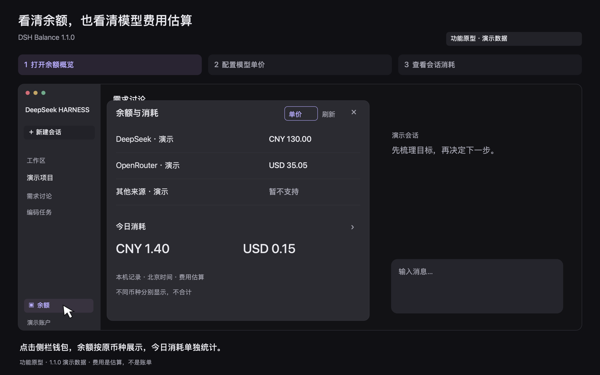
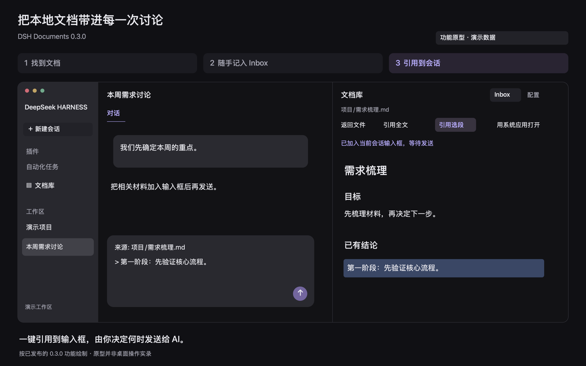

# deepseek-harness-plugin

中文 | [English](README.en.md)

独立开发的 DeepSeek Harness 社区插件集合。每个插件在一个独立子目录中维护源码、依赖、测试和说明，并单独发布安装包。

## 开发与维护说明

这些插件都源于我自己的实际需求，首先服务于个人使用，并未进行全面的兼容性与适配测试。各插件已验证的范围以对应说明为准。

欢迎通过 [Issues](https://github.com/pipilu123566/deepseek-harness-plugin/issues) 提出问题和建议。如果某项需求对我自己也有用，我会积极开发；其他需求大概率不会实现。也欢迎 Fork 到自己的仓库，按自己的需要继续开发和完善。

我还是编程新手，这些插件全部通过 AI 开发完成。代码和设计如有不足，欢迎指正。

## 插件

| 插件 | 用途 | 已发布版本与安装 | 兼容宿主 |
| --- | --- | --- | --- |
| [DSH Balance](dsh-balance/README.md) | 查看账户余额、今日及会话消耗，配置模型单价 | [1.1.0 Release](https://github.com/pipilu123566/deepseek-harness-plugin/releases/tag/%40pipilu123566%2Fdsh-balance%401.1.0) | DeepSeek Harness 0.2.1-rc.5 |
| [DSH 远程桌面](dsh-remote-desktop/README.md) | 手机浏览器远控 Mac、键鼠输入、双指缩放和平移 | [0.4.1 预览版](https://github.com/pipilu123566/deepseek-harness-plugin/releases/tag/%40pipilu%2Fdsh-remote-desktop%400.4.1) | DeepSeek Harness 0.2.1-rc.5 |
| [DSH 文档库](dsh-documents/README.md) | 本地文档浏览、固定 Inbox、实时预览与自动保存、手动引用 | [0.3.0 Release](https://github.com/pipilu123566/deepseek-harness-plugin/releases/tag/%40pipilu123566%2Fdsh-documents%400.3.0) | DeepSeek Harness 0.2.1-rc.5 |

各插件的功能、安装步骤和支持范围见对应目录的说明。

### 使用演示

以下包含实际插件界面与功能原型，具体来源见对应插件首页。点击预览进入插件首页，查看完整动图、静态分步和支持范围。

| 余额与消耗 · 1.1.0 | 远程桌面 · 0.4.1 预览版 | 文档库 · 0.3.0 |
| --- | --- | --- |
| [](dsh-balance/README.md#使用演示) | [](dsh-remote-desktop/README.md#使用演示) | [](dsh-documents/README.md#使用演示) |
| 看余额、设置单价、按会话查看费用估算 | 手机连接 Mac、缩放定位、文字输入与断开 | 找文档、追加 Inbox、引用到会话 |

仓库根目录不是插件。安装时进入对应插件说明，下载该插件的 Release `.tgz`，不要把本仓库根地址直接交给插件安装命令。已发布版本的支持范围以其 README 和验收记录为准。

## 目录与开发

```text
deepseek-harness-plugin/
├── README.md
├── README.en.md
├── CONTRIBUTING.md
├── LICENSE
├── dsh-balance/
└── dsh-documents/
    ├── package.json
    ├── pnpm-lock.yaml
    ├── README.md
    ├── README.en.md
    ├── LICENSE
    └── 源码、测试与文档
```

后续插件在根下新建独立目录；每个目录保留自己的版本、依赖、锁文件、测试与安装说明。开发和打包在目标插件目录内执行，不需要同时安装所有插件的依赖。详见[贡献与发布约定](CONTRIBUTING.md)。

问题反馈请在 [Issues](https://github.com/pipilu123566/deepseek-harness-plugin/issues) 中注明插件名称、版本和宿主版本。余额插件的[官方展示帖](https://github.com/deepseek-ai/deepseek-harness/discussions/11526)继续使用原帖。

## 许可证

自有代码采用 [MIT](LICENSE)。每个插件的安装包包含其许可证；第三方依赖保留各自许可。
