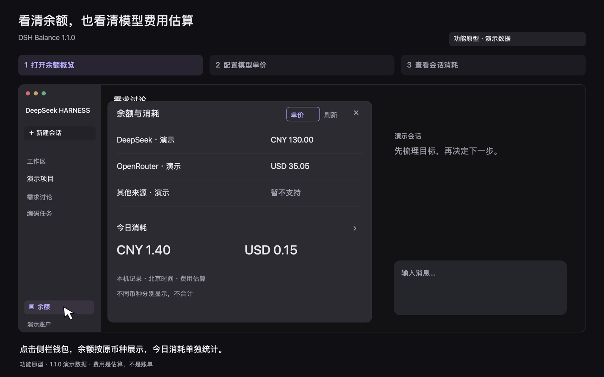
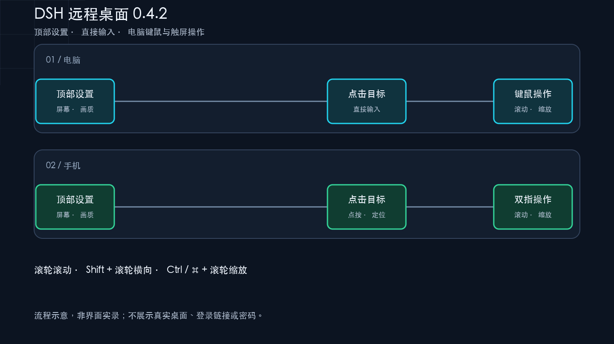
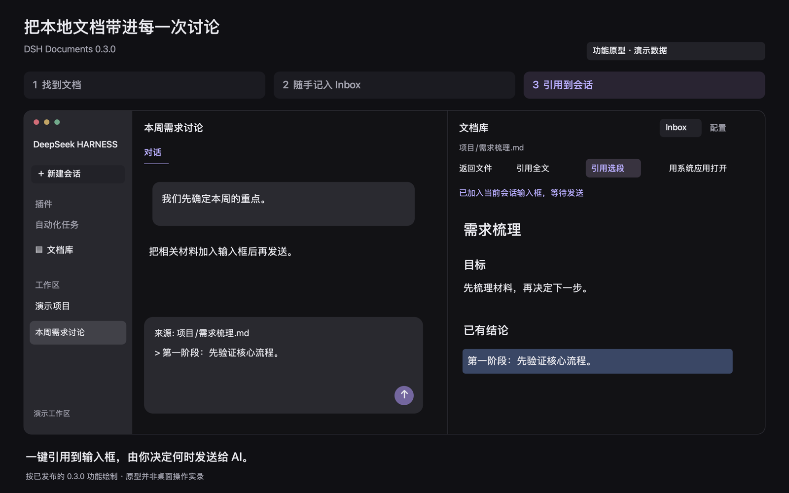

# deepseek-harness-plugin

中文 | [English](README.en.md)

为 DeepSeek Harness 添加余额与消耗查看、Mac 远程操作和本地文档库。按需要选择插件，查看效果后进入对应说明安装。

## 插件

### 余额与消耗 · DSH Balance 1.1.0

想知道账户还剩多少、今天花了多少、费用集中在哪段会话？在侧栏查看余额和费用估算，按模型或会话展开，并设置自己的模型单价。

1.1.0 功能原型，金额与单价为演示数据。[查看演示与安装说明](dsh-balance/README.md) · [下载 1.1.0](https://github.com/pipilu123566/deepseek-harness-plugin/releases/tag/%40pipilu123566%2Fdsh-balance%401.1.0)

### 远程桌面 · 0.4.2 预览版

通过电脑、手机或 iPad 的浏览器查看和操作 Mac，支持键鼠输入与触摸缩放。被控电脑需为 Apple Silicon Mac，运行 macOS 13 或以上；连接条件和已验证范围见插件说明。

0.4.2 操作流程示意，非界面实录。[查看演示与安装说明](dsh-remote-desktop/README.md) · [下载预览版](https://github.com/pipilu123566/deepseek-harness-plugin/releases/tag/%40pipilu%2Fdsh-remote-desktop%400.4.2)

### 文档库 · 0.3.0

在会话旁浏览和编辑本地资料，随手追加到 Inbox，再把选段引用到会话输入框。编辑会写回原文件，引用后由你确认发送。

0.3.0 功能原型，使用演示文档。[查看演示与安装说明](dsh-documents/README.md) · [下载 0.3.0](https://github.com/pipilu123566/deepseek-harness-plugin/releases/tag/%40pipilu123566%2Fdsh-documents%400.3.0)

## 开始使用

当前公开版本适配 **DeepSeek Harness 0.2.1-rc.5**，平台和功能范围以各插件说明为准。

1. 选择上面的插件，打开其安装说明。
2. 下载该插件 Release 中的 `.tgz`，按已验证步骤安装。
3. 打开插件，完成首次配置或操作。

本仓库提供多个独立插件，安装时选择对应插件包；仓库根地址和 GitHub 自动生成的源码压缩包不能代替安装包。

## 开发与维护说明

这些插件都源于我自己的实际需求，首先服务于个人使用，并未进行全面的兼容性与适配测试。各插件已验证的范围以对应说明为准。

欢迎通过 [Issues](https://github.com/pipilu123566/deepseek-harness-plugin/issues) 提出问题和建议。如果某项需求对我自己也有用，我会积极开发；其他需求大概率不会实现。也欢迎 Fork 到自己的仓库，按自己的需要继续开发和完善。

我还是编程新手，这些插件全部通过 AI 开发完成。代码和设计如有不足，欢迎指正。

## 反馈与贡献

遇到问题，请在 [Issues](https://github.com/pipilu123566/deepseek-harness-plugin/issues) 中注明插件名称、版本和宿主版本。参与开发请阅读[贡献与发布约定](CONTRIBUTING.md)；余额插件也可在[官方展示帖](https://github.com/deepseek-ai/deepseek-harness/discussions/11526)交流。

## 许可证

自有代码采用 [MIT](LICENSE)。每个插件的安装包包含其许可证；第三方依赖保留各自许可。
