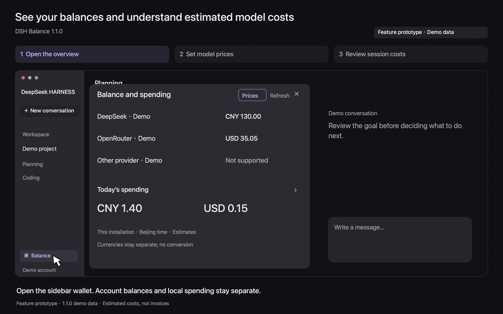

# DSH Balance

[中文](README.md) | English

> **No longer maintained (2026-11-06).** This project receives no further updates, issues are not accepted, and bugs are not fixed. The source and the 1.1.0 package stay as they are, and existing download links keep working. Fork it if you want to keep it going.

See what remains in your accounts, how much you spent today, and where the costs come from by model or session, all in the DeepSeek Harness sidebar.

[Download 1.1.0](https://github.com/pipilu123566/deepseek-harness-plugin/releases/tag/%40pipilu123566%2Fdsh-balance%401.1.0) · [Report a problem](https://github.com/pipilu123566/deepseek-harness-plugin/issues)

## See the workflow

Open the sidebar wallet → inspect balances and daily spending → save model prices and recalculate → review costs by session.



A 1.1.0 feature prototype, not a screen recording. Amounts, models and prices are demonstration data, not real balances, official rates or invoices.

<details>
<summary>Static steps and an actual runtime screenshot</summary>

 [Overview](media/balance-1.1.0-overview.en.png) · [Model prices](media/balance-1.1.0-prices.en.png) · [Session spending](media/balance-1.1.0-sessions.en.png). An [actual runtime screenshot using demo data](docs/images/balance-1.1.0-demo.png) is also available.

</details>

## What you can do

### Check account balances

Open the sidebar wallet to see available balances for configured providers. Expand a provider for top-up, granted funds and timestamps. Multiple models from the same provider share one row; currencies stay separate.

### Find where the costs come from

Open “Today's spending” to inspect model or session costs and expand a session's model breakdown. Each reply also shows its turn cost. Amounts estimate recorded usage in the current host, rather than provider bills.

### Set prices for your models

In “Prices”, choose an exact provider/model and enter input, output and optional cache prices. Saving recalculates estimates and persists across restarts. Missing prices and usage remain explicit.

## Compatibility

For **DeepSeek Harness 0.2.1-rc.5**. The wallet appears above the account button in the sidebar footer. Other host versions have not been verified.

These plugins are primarily built for the author's own needs and have not undergone comprehensive compatibility testing. See the [validation record](docs/validation.en.md) for the public release's tested platforms, installation and interaction coverage.

## Install or upgrade

1. Download [`pipilu123566-dsh-balance-1.1.0.tgz`](https://github.com/pipilu123566/deepseek-harness-plugin/releases/download/%40pipilu123566%2Fdsh-balance%401.1.0/pipilu123566-dsh-balance-1.1.0.tgz) from the Release. This is the installable plugin package; GitHub's automatically generated source archive is not a substitute.
2. Fully quit Harness, then run this from the download directory:

   ```sh
   dsh plugin --profile desktop add ./pipilu123566-dsh-balance-1.1.0.tgz --ignore-scripts
   ```

3. Reopen Harness and find the wallet button at the bottom of the sidebar. Configure provider connections in the existing Harness settings.

## First use

1. Configure provider connections through the existing Harness settings. Sign in through the host when using a DeepSeek signed-in account.
2. Hover or focus the sidebar wallet to open it, or click to pin it. Close it with Escape, the close button or an outside click.
3. Open “Today's spending” for model/session breakdowns. If a third-party model is unpriced, open “Prices”, enter its rates, and save to recalculate.

Overview amounts use two decimal places; expanded details retain precision. Provider and detail lists scroll. Refresh runs once per minute while open and stops when closed; manual refresh is available. Missing credentials, unsupported providers, rate limits and failures have distinct states.

<details>
<summary>macOS CLI path, Web profiles, upgrades and removal</summary>

On macOS, if `dsh` is not on your PATH, use the application's CLI:

```sh
'/Applications/DeepSeek Harness.app/Contents/Resources/runtime/cli/bin/dsh' plugin --profile desktop add ./pipilu123566-dsh-balance-1.1.0.tgz --ignore-scripts
```

Upgrade public version 1.0.0 using the same steps. For an existing Web profile, replace `desktop` with its name and stop/restart that instance around package changes. Keep only one balance bundle in a profile. Do not install the parent repository root as a plugin.

To uninstall, quit the target instance, run this command and reopen it:

```sh
dsh plugin --profile desktop remove @pipilu123566/dsh-balance
```

</details>

## Balance sources

Supports DeepSeek signed-in accounts, DeepSeek API, OpenRouter and SiliconFlow. OpenRouter balance queries require a management key. Prices can still be set for other configured models to estimate costs.

<details>
<summary>Provider support and query requirements</summary>

| Provider | Source | Requirements and limits |
| --- | --- | --- |
| DeepSeek signed-in account | Harness account service | Sign in through Harness; top-up and granted wallets are shown by currency |
| DeepSeek API | Official `/user/balance` | Official API key; available, top-up and granted balances |
| OpenRouter | Official `/api/v1/credits` | Requires a management key; ordinary keys may be denied; total credits minus usage |
| SiliconFlow | Official `/v1/user/info` | Key for `api.siliconflow.cn`; amounts in CNY |
| Alibaba Cloud Bailian / Qwen | Balance query not integrated | A model API key cannot directly query the cloud account's cash balance; account funds and Token Plan / Coding Plan quotas are distinct |
| Other configured providers | Balance query unsupported | No guessed private endpoints; model prices can still be configured to estimate recorded usage |

API references: [DeepSeek](https://api-docs.deepseek.com/api/get-user-balance/), [OpenRouter](https://openrouter.ai/docs/api/api-reference/credits/get-remaining-credits), [SiliconFlow](https://github.com/siliconflow/siliconcloud/blob/main/openapi.yaml), [Alibaba Cloud account balance](https://help.aliyun.com/zh/user-center/developer-reference/api-bssopenapi-2017-12-14-queryaccountbalance).

Only configured providers are queried. Credentials go only to the corresponding allowlisted HTTPS endpoint. Custom reverse proxies, nonstandard ports, credentials embedded in URLs and redirects are rejected. A balance is a timestamped snapshot, not a live account-change feed.

</details>

## Usage and pricing

Days use Beijing time. Totals cover recorded, priced model calls in this host, excluding other devices, unrecorded requests and tool charges such as search or fetch. Currencies remain separate; missing prices or usage are marked as partial estimates.

Built-in official prices use the 2026-10-30 snapshot and apply to 2026-09-19 through 2026-12-31. The table does not update automatically. Custom prices recalculate existing records.

<details>
<summary>Accounting scope, price validity and custom-price rules</summary>

Amounts are **model-cost estimates, not provider billing statements**. They cover recorded model usage in sessions accessible to the current host, excluding other devices, unrecorded requests and tool charges such as search or fetch. Days use Beijing time. Inherited fork calls are not charged twice, and reasoning tokens already included in output are not counted again.

Missing usage, missing prices and unreadable sessions remain visible. Mixed results total only priced calls and indicate partial estimates. CNY and USD are never added together. Session lists include only sessions with calls that day, use titles from the host projection, and label untitled sessions explicitly.

Built-in prices for official DeepSeek routes use the [official CNY prices checked on 2026-10-30](https://api-docs.deepseek.com/zh-cn/quick_start/pricing/), including Beijing peak/off-peak periods. The built-in date range is 2026-09-19 through 2026-12-31. Outside that range, unknown models and identically named models on third-party routes do not automatically receive these prices. Prices may change; override them in the price editor as needed. The plugin does not automatically update its price table.

Custom prices are keyed by exact `provider/model`, support CNY and USD, and use currency per million tokens with up to eight decimal places. Input and output prices are required. An empty cache price means unpriced; enter `0` only for a free category. Saving recalculates existing records with the current settings, which cannot reconstruct historical provider tariffs or actual bills. Reset restores built-in pricing on supported official routes and leaves other routes unpriced. Concurrent configuration changes are rejected; reload before editing again.

</details>

## Data and development

API keys and raw provider responses stay on the Host. The client receives display fields such as balances, usage, model identifiers and session titles, not conversation bodies. The plugin adds no analytics or separate backend. Balance queries do not append session events; prices are saved through Harness settings.

<details>
<summary>Development environment and implementation</summary>

Use the pinned Node **22.21.1**, pnpm **10.33.2** and lockfile inside the plugin directory:

```sh
pnpm install --frozen-lockfile --ignore-scripts
pnpm test
pnpm pack --out /path/to/output/dsh-balance.tgz
```

The Host uses Cordis, Typert, session queries and projections. The client reuses the host's React, theme and locale services and renders in public sidebar and turn-tail slots. Disposal releases listeners, timers, popovers, observation leases and in-flight requests. See [contributing](CONTRIBUTING.md) and the [validation record](docs/validation.en.md).

</details>

## License

[MIT](LICENSE). Third-party dependencies retain their own licenses.
