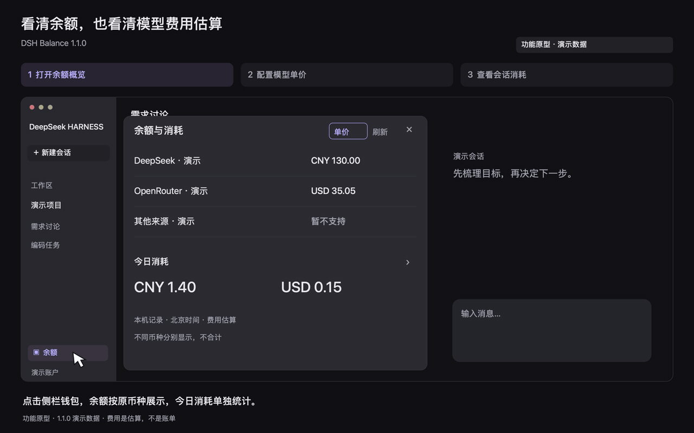

# DSH Balance

中文 | [English](README.en.md)

> **已停止维护（2026-11-06）。** 本项目不再更新，不接受 Issue，也不修复问题。源码和 1.1.0 安装包保留原样，已有下载链接继续有效。需要继续使用时请自行 Fork 维护，或参考同类插件。

在 DeepSeek Harness 侧栏看账户还剩多少、今天花了多少，再按模型或会话找到费用来源。

[下载 1.1.0](https://github.com/pipilu123566/deepseek-harness-plugin/releases/tag/%40pipilu123566%2Fdsh-balance%401.1.0) · [问题反馈](https://github.com/pipilu123566/deepseek-harness-plugin/issues)

## 使用演示

打开侧栏钱包 → 查看余额和今日消耗 → 配置模型单价并重算 → 按会话定位花费。



1.1.0 功能原型，非操作实录；金额、模型和单价均为演示数据，不代表真实账户、官方报价或账单实扣。

<details>
<summary>查看静态分步图与实际运行截图</summary>

[余额概览](media/balance-1.1.0-overview.zh.png) · [配置单价](media/balance-1.1.0-prices.zh.png) · [会话消耗](media/balance-1.1.0-sessions.zh.png)；另有[实际运行的演示数据截图](docs/images/balance-1.1.0-demo.png)。

</details>

## 能用它做什么

### 查看账户余额

打开侧栏钱包，集中查看已配置来源的可用余额；点击来源展开充值、赠送和更新时间。同一来源配置多个模型只显示一行，不同币种分别展示。

### 找到费用花在哪

点击「今日消耗」，按模型或会话查看费用，会话内还可展开模型明细；每轮回复尾部也会显示该轮费用。金额是当前宿主已记录用量的估算，不等于厂商账单。

### 为自己的模型设置单价

在「单价」中选择厂商／模型，填写输入、输出及可选缓存价格。保存后立即重算，重启后保留；未定价和缺失用量会单独提示。

## 兼容范围

适用：**DeepSeek Harness 0.2.1-rc.5**。余额入口位于侧栏底部账户按钮上方；其他宿主版本尚未验证。

这些插件首先服务于作者自己的使用需求，未做全面适配测试。公开版本的实际测试平台、安装和交互覆盖见[验收记录](docs/validation.md)。

## 安装与升级

1. 从 Release 下载 [`pipilu123566-dsh-balance-1.1.0.tgz`](https://github.com/pipilu123566/deepseek-harness-plugin/releases/download/%40pipilu123566%2Fdsh-balance%401.1.0/pipilu123566-dsh-balance-1.1.0.tgz)。这是可安装插件包；GitHub 自动生成的源码压缩包不能代替它。
2. 完全退出 Harness，在下载目录执行：

   ```sh
   dsh plugin --profile desktop add ./pipilu123566-dsh-balance-1.1.0.tgz --ignore-scripts
   ```

3. 重新打开 Harness，在侧栏底部找到钱包按钮。厂商连接仍通过 Harness 原有设置配置。

## 第一次使用

1. 通过 Harness 原有设置配置厂商连接；使用 DeepSeek 登录账户时，先在宿主登录。
2. 悬浮或键盘聚焦侧栏钱包查看余额，点击可固定面板；按 Escape、关闭按钮或点击外部收起。
3. 点击「今日消耗」查看模型／会话明细。第三方模型未定价时，先打开「单价」填写价格，再保存重算。

概览金额保留两位小数，展开明细保留精度。来源和明细列表可滚动；打开期间每分钟更新，也可手动刷新，关闭后停止轮询。凭据缺失、不支持、限流和失败会分别提示。

<details>
<summary>macOS 命令路径、Web profile、升级与卸载</summary>

macOS 若没有 `dsh` 命令，可使用应用自带 CLI：

```sh
'/Applications/DeepSeek Harness.app/Contents/Resources/runtime/cli/bin/dsh' plugin --profile desktop add ./pipilu123566-dsh-balance-1.1.0.tgz --ignore-scripts
```

已有公开版 1.0.0 按相同步骤安装新版。使用已有 Web profile 时，将 `desktop` 换成其名称，并在包变更前后停止、重启实例。同一 profile 只保留一个余额 bundle；不要将父仓库根地址作为插件安装。

卸载前退出目标实例，然后执行并重新打开：

```sh
dsh plugin --profile desktop remove @pipilu123566/dsh-balance
```

</details>

## 余额来源

支持 DeepSeek 登录账户、DeepSeek API、OpenRouter 和硅基流动；OpenRouter 余额查询需要管理密钥。其他已配置模型仍可设置单价、估算费用。

<details>
<summary>查看厂商支持与查询条件</summary>

| 厂商 | 来源 | 条件与限制 |
| --- | --- | --- |
| DeepSeek 登录账户 | Harness 账户服务 | 通过 Harness 登录；按币种显示充值与赠送钱包 |
| DeepSeek API | 官方 `/user/balance` | 配置官方 API Key；显示可用、充值和赠送余额 |
| OpenRouter | 官方 `/api/v1/credits` | 需要管理密钥；普通密钥可能无权查询；显示总充值减总消费 |
| 硅基流动 | 官方 `/v1/user/info` | 配置 `api.siliconflow.cn` 密钥；金额为 CNY |
| 百炼／Qwen | 尚未接入余额查询 | 模型调用密钥不能直接查询阿里云账户现金余额；不将账户余额与 Token Plan / Coding Plan 混用 |
| 其他已配置厂商 | 暂不支持余额查询 | 不猜测私有接口；仍可为其模型配置单价并估算已记录用量的费用 |

接口来源：[DeepSeek](https://api-docs.deepseek.com/api/get-user-balance/)、[OpenRouter](https://openrouter.ai/docs/api/api-reference/credits/get-remaining-credits)、[硅基流动](https://github.com/siliconflow/siliconcloud/blob/main/openapi.yaml)、[阿里云账户余额](https://help.aliyun.com/zh/user-center/developer-reference/api-bssopenapi-2017-12-14-queryaccountbalance)。

插件只查询已配置的来源。凭据仅发送到对应 HTTPS 白名单端点；拒绝自定义反向代理、非标准端口、URL 内嵌凭据和接口重定向。余额是带更新时间的查询快照，不代表账户的实时变化。

</details>

## 消耗与计价

今日按北京时间统计，仅汇总本宿主已记录且能计价的模型调用；不包含其他设备、未记录请求及搜索、抓取等工具费用。币种不混合，缺价或缺失用量时会标明部分估算。

内置官方价格使用 2026-10-30 快照，适用日期为 2026-09-19 至 2026-12-31，价格表不自动更新。自定义单价会重算已有记录。

<details>
<summary>查看计价口径、价格有效期与单价设置规则</summary>

金额是**模型费用估算，不是厂商扣款账单**。统计范围为当前宿主可访问的会话及其中已记录的模型用量；不包含其他设备、未记录请求，以及搜索、抓取等工具费用。当日按北京时间划分，fork 继承调用不重复计费；推理用量已包含在输出中，不另加一次。

未上报用量、缺少单价和会话读取失败均保留提示。混合结果只汇总已计价部分，并标明部分估算；人民币和美元不合计。会话列表只显示当日有调用的会话，标题来自宿主投影；未命名会话保留明确提示。

内置 DeepSeek 官方路线价格采用 [2026-10-30 核对的官方人民币价格](https://api-docs.deepseek.com/zh-cn/quick_start/pricing/)，按北京时间峰谷时段计算；内置日期覆盖为 2026-09-19 至 2026-12-31。超出日期范围、未知模型和第三方同名模型不会自动套用该价格。价格可能变动，可在「单价」中显式覆盖；本插件不自动更新价格表。

自定义单价按精确 `provider/model` 保存，支持 CNY、USD，单位为所选币种／百万 Token，最多 8 位小数。输入、输出为必填项；缓存价格留空表示未定价，填 `0` 才表示免费。保存会重新计算已有记录；当前配置不能还原厂商过去的价格和真实账单。恢复默认后，官方路线使用内置价格，其他路线保持未定价。并发配置变更会拒绝覆盖，需要重新载入后再编辑。

</details>

## 数据与开发

API Key 和原始厂商响应留在 Host；页面接收余额、用量、模型标识和会话标题等展示字段，不返回会话正文。插件不增加分析追踪或独立后端；余额查询不追加会话事件，单价通过 Harness 设置服务保存。

<details>
<summary>开发环境与实现</summary>

使用仓库声明的 Node **22.21.1**、pnpm **10.33.2** 和锁文件，在插件目录执行：

```sh
pnpm install --frozen-lockfile --ignore-scripts
pnpm test
pnpm pack --out /path/to/output/dsh-balance.tgz
```

Host 使用 Cordis、Typert、会话查询与投影服务；Client 复用宿主 React、主题及语言服务，在侧栏和回复尾部的公开槽位显示内容。卸载时释放监听器、计时器、浮层、观察租约和在途请求。详见[贡献说明](CONTRIBUTING.md)与[验收记录](docs/validation.md)。

</details>

## 许可证

[MIT](LICENSE)。第三方依赖保留各自的许可证。
