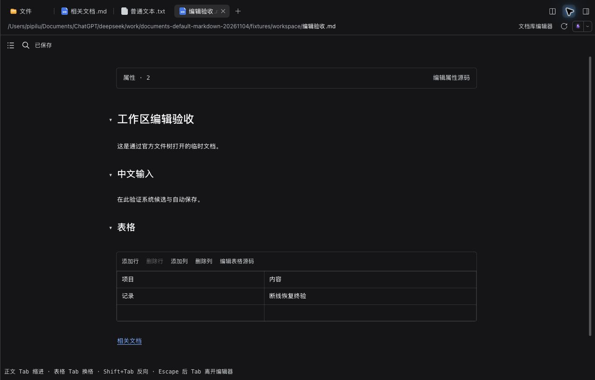
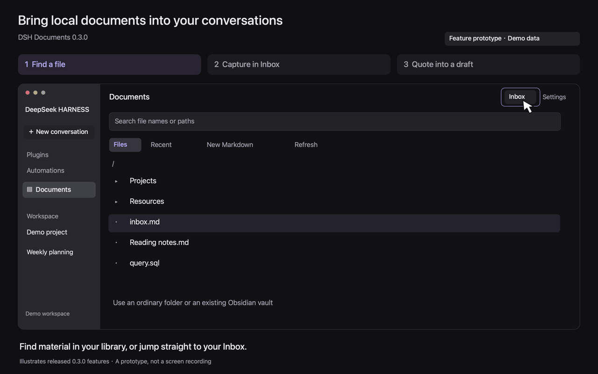

# DSH Documents

[中文](README.md) | English

Browse and edit local documents in DeepSeek Harness, capture notes into a fixed Inbox, and quote selections into AI conversations. Optionally use the same editor for Markdown opened from the official file tree: files stay in place and edits save back to the originals.

Version **0.9.0** targets **DSH 0.2.1-rc.5**. This is an unofficial community plugin. A library may be an Obsidian vault or an ordinary folder; no Obsidian plugin is required.

## See the workflow



Actual 0.9.0 Web interface, in Chinese, using temporary demo documents. Open Markdown from the official file tree, edit in its existing tab, navigate the outline, view collapsed properties and edit tables with autosave. The opening and saving path has also been verified on Mac Desktop.

<details>
<summary>Library, Inbox and conversation-quoting prototype</summary>



An approximately 14-second loop with demo data. This feature prototype was drawn for 0.3.0 and illustrates the retained basic workflow; the current interface has updated controls. Static steps: [Browse](media/documents-0.3.0-browse.en.png) · [Inbox autosave](media/documents-0.3.0-inbox.en.png) · [Quote into a draft](media/documents-0.3.0-quote.en.png).

</details>

## Install and get started

Verified on macOS arm64 Desktop and isolated Web. Other systems and host versions are unverified; the Mac global capture window requires Apple Silicon. **Edits overwrite the original file.** A successful local save does not mean cloud synchronization has completed.

1. Download the [standalone package](https://github.com/pipilu123566/deepseek-harness-plugin/releases/download/%40pipilu123566%2Fdsh-documents%400.9.0/pipilu123566-dsh-documents-0.9.0.tgz) and `SHA256SUMS` from the [0.9.0 Release](https://github.com/pipilu123566/deepseek-harness-plugin/releases/tag/%40pipilu123566%2Fdsh-documents%400.9.0).
2. Install the `.tgz` in DSH’s Plugins page. Upgrades retain the same package name. If a restart is required, wait for active tasks to finish. Do not modify a running Desktop profile from an external CLI.
3. Open **Documents** from the global sidebar or a conversation’s right-sidebar start page, then open its gear settings and choose a workflow below. Interface labels are currently Chinese.

| Goal | First setup and action |
| --- | --- |
| Edit workspace Markdown directly | Enable “用文档库编辑器默认打开 Markdown” and save settings, then open `.md` / `.markdown` from the official file tree. Off by default; no library root or Inbox is required. Other formats retain their opener. Disabling restores official preview; tabs with an explicit viewer choice follow host selection rules |
| Browse a personal library | Set an absolute root such as `/path/to/Vault`, save, then browse the library tree. This does not change the conversation working directory |
| Append to Inbox | Set an existing file relative to the root, such as `KnowledgeOS/inbox.md`. “打开 Inbox” opens it at the end for continued writing |
| Capture notes or write fullscreen | Choose “打开随记” in settings. Drafts persist automatically; “追加到 Inbox” or Cmd/Ctrl+Enter submits. On Mac, enable the ⌥ Space global window after disabling the old capture plugin. Remote users use the in-page capture entry |

For a standalone Web profile:

```sh
dsh plugin --profile <profile> add /absolute/path/pipilu123566-dsh-documents-0.9.0.tgz --ignore-scripts
```

The repository root and GitHub-generated source archives are not plugin packages. No npm package is published, and no unverified Git-subdirectory install command is provided. Root, Inbox and other preferences live in `DSH_HOME/document-library/state.json`, outside the package.

## Everyday use

- **Find files:** expand library folders, create Markdown/folders, expand or collapse all. The locate-current-file button explicitly unfolds and highlights the current file; the whole tree can be hidden. New notes receive `.md` without overwriting existing names. Hidden files and symlinks are omitted. There are no search, recent-file, bookmark or sort controls.
- **Write Markdown:** live preview is the only default mode, showing syntax at the caret or selection. Documents, Inbox, Web capture and the Mac window share an editor. It supports headings, lists, emphasis, tasks, Wikilinks/aliases, Callouts, local images, highlighted code and Mermaid diagrams. Invalid/oversized diagrams retain source; ordinary code never executes and external links do not open automatically.
- **Navigate:** the outline shows H1–H6 and Setext headings; selecting one unfolds and locates its section. Heading links support Chinese fragments; ambiguous filenames prompt for a choice. Library Back/Forward retains up to 50 positions, including caret and scroll. Heading sections fold; code/metadata pseudo-headings are omitted. Block-reference navigation and drag-reordering are not implemented.
- **Properties and tables:** complete frontmatter appears as a collapsed, read-only projection with source editing, without reserializing YAML. Click table cells, add/delete rows and columns, or edit source. Tab/Shift+Tab move between cells, Enter moves down, Escape returns to the document, with shared undo. Pasted newlines become `<br>` and pipes are escaped. Grid paste, formulas, sorting, merged cells and drag-reordering are not included.
- **Find and type:** Cmd/Ctrl+F searches this document; Enter/Shift+Enter navigate matches. Cmd/Ctrl+B / I toggle bold/italic. In prose, Tab inserts a literal tab or indents; Shift+Tab outdents. Escape followed by Tab leaves the editor. IME candidate keys remain with the input method, and saving waits for composition to finish.
- **Save safely:** edits autosave after about 700 ms of inactivity, with no Save button; Cmd/Ctrl+S saves immediately. Navigation first completes the pending save. Failed saves or external conflicts retain the draft and stop overwriting. Clean files refresh after external changes. There is no diff merge or version history.
- **Quote for AI:** the conversation document panel adds a full document or selection to the composer with a relative source path; unsaved text is labeled as a draft. The user sends it explicitly. Images/PDFs are not automatically transcribed.
- **Other formats:** the separate library edits SQL, JSON, Python and other UTF-8 text, previews PNG/JPEG/GIF/WebP and PDF, and opens Excel/PPT through the host system application. The workspace preference only handles `.md` / `.markdown`; other official viewers remain in place.

## Remote use and recovery

Remote browsers edit host files over DSH’s authenticated connection, without a client-side Obsidian installation. Workspace editing is restricted to Markdown inside the session root and respects read-only mode; uncertain permissions stay read-only. Complete reads and version-guarded saves preserve UTF-8 BOM, CRLF and final newlines. Use the host’s **Open with** menu for oversized, non-UTF-8, out-of-workspace or unsuitable Markdown. No external SSH host or separate remote device was tested.

Library recovery copies live on the DSH host. Workspace Markdown additionally stores asynchronous browser IndexedDB copies and mirrors them to the host. After disconnects or save failures, completed backups can be recovered explicitly, copied or discarded; a changed original pauses autosave. Recovery is bounded to 20 drafts / 20 MiB, without automatic eviction of pending drafts. Full or unavailable storage is reported. Input without a completed backup, uncommitted candidates, power loss and disk failure cannot be guaranteed recoverable. Keep the original page open until recovery exists.

Capture drafts persist separately; fixed-Inbox submission supports retry deduplication and interruption recovery. Conflicts retain drafts rather than overwrite existing text. Caret, scroll and tree state belong to the current client, do not modify Obsidian documents, and do not imply cross-device synchronization.

## Boundaries and validation

- The library has one root and one file per view. Obsidian community-plugin semantics, Canvas, Bases and complex formulas are outside the scope. Limits are 5 MiB for text and 25 MiB for images/PDFs. Windows external-app opening is not implemented; Web’s system opener runs on the host machine.
- Interactive tables are limited to 200,000 characters, 50 columns and 5,000 cells; larger tables retain source. Property projections are limited to 400 lines / 64 KiB; incomplete metadata retains source. Internal Wikilink lookup scans at most 20,000 entries and returns 200 matches.
- Outlines parse on demand in a bundled worker without a vault-wide index. If workers are unavailable, documents above 200,000 characters omit the outline but retain editing and Find. New input cancels stale work; ordinary edits reuse preview decorations.
- Save-time version guards are not distributed locks or cloud transactions. Disabling the preference first flushes saves; active composition or failed saves keep the editor available. Other online clients poll the preference about every five seconds, protecting their own drafts first.
- The [0.9.0 validation record](docs/validation-0.9.0.en.md) distinguishes 115 automated checks, actual Web/Desktop, native IME and disconnect recovery. The joint native-candidate test after adding browser recovery was deferred and is not a pass. Other platforms, remote devices and IMEs remain unverified. Build timing is not physical input latency.

## Development and feedback

Use Node **24.16.0**, pnpm **10.33.2** and `pnpm-lock.yaml`: `pnpm install --frozen-lockfile --ignore-scripts`, `pnpm test`, `pnpm build`, `pnpm pack`. The client uses host React and public extension points. Uninstall releases listeners and polling without deleting documents.

Include the plugin, package version and DSH version in [Issues](https://github.com/pipilu123566/deepseek-harness-plugin/issues). See the [repository’s maintenance policy](../README.en.md#development-and-maintenance). Original code is [MIT](LICENSE); dependencies retain their [third-party licenses](THIRD_PARTY_NOTICES.md).
