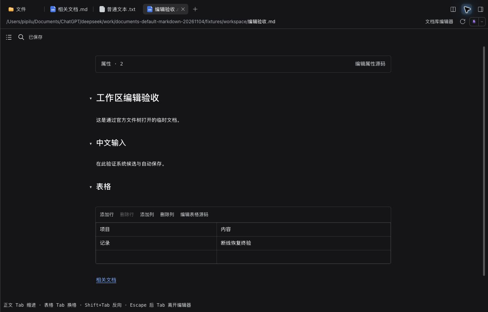
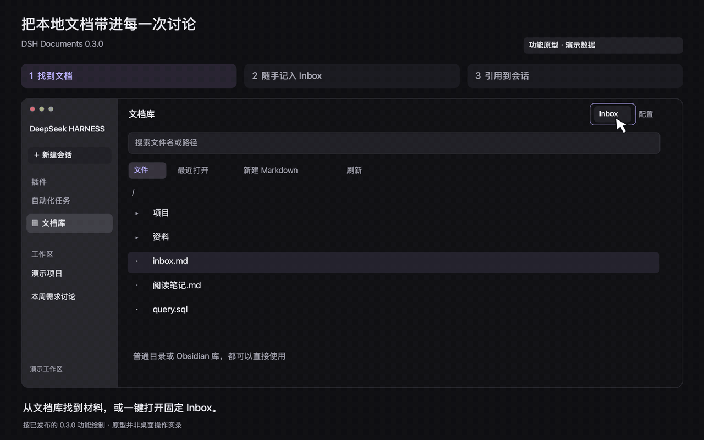

# DSH 文档库

中文 | [English](README.en.md)

在 DeepSeek Harness 中浏览和编辑本地资料、随手记到固定 Inbox，再把选段引用给 AI。也可选择直接接管官方文件树中的 Markdown：文件仍在原目录，编辑自动保存回原文件。

当前版本 **0.9.0**，适配 **DSH 0.2.1-rc.5**。非官方社区插件；目录可以是 Obsidian 文档库，也可以是普通文件夹，无需安装 Obsidian 插件。

## 使用演示



0.9.0 实际 Web 界面，使用临时演示文档。通过官方文件树打开 Markdown，可在原标签页编辑，查看大纲、折叠属性、编辑表格并自动保存。Mac Desktop 也已验证这条打开和保存路径。

<details>
<summary>查看文档库、Inbox 与会话引用的流程原型</summary>



约 14 秒循环，使用演示数据；这是按 0.3.0 绘制的功能原型，展示仍保留的基本流程，按钮布局以新版实际界面为准。静态步骤：[浏览文档](media/documents-0.3.0-browse.zh.png) · [Inbox 自动保存](media/documents-0.3.0-inbox.zh.png) · [引用到会话](media/documents-0.3.0-quote.zh.png)。

</details>

## 安装与第一次使用

已验证 macOS arm64 的 Desktop 和隔离 Web。其他系统及宿主版本未验证；Mac 全局随记仅支持 Apple Silicon。**编辑会直接写回原文件**，本机保存成功不代表云同步完成。

1. 从 [0.9.0 Release](https://github.com/pipilu123566/deepseek-harness-plugin/releases/tag/%40pipilu123566%2Fdsh-documents%400.9.0) 下载 [独立安装包](https://github.com/pipilu123566/deepseek-harness-plugin/releases/download/%40pipilu123566%2Fdsh-documents%400.9.0/pipilu123566-dsh-documents-0.9.0.tgz) 和 `SHA256SUMS`。
2. 在 DSH「插件」页安装 `.tgz`。升级保持同一包名；需要重启时，先等待运行任务结束。不要在 Desktop 运行时从外部命令行改写其 profile。
3. 点击全局「文档库」，或会话右侧开始页的「文档库」，打开左侧齿轮设置，选择以下用法。

| 想做什么 | 首次设置与操作 |
| --- | --- |
| 直接编辑会话工作区的 Markdown | 勾选「用文档库编辑器默认打开 Markdown」并保存配置，再从官方文件树打开 `.md` / `.markdown`。默认关闭，不需要设置文档库根目录或 Inbox；其他格式继续原打开方式。取消勾选可恢复官方预览；手动指定过查看器的标签遵循宿主选择规则 |
| 浏览自己的资料目录 | 设置绝对根目录，例如 `/path/to/Vault`，保存后使用文档库文件树。不会改变会话工作目录 |
| 随时追加到 Inbox | 设置目录内已有文件的相对路径，例如 `KnowledgeOS/inbox.md`。在设置页点击「打开 Inbox」，定位末尾继续写 |
| 随记与全屏记录 | 在设置页点击「打开随记」。草稿自动保留；「追加到 Inbox」或 Cmd/Ctrl+Enter 才提交。Mac 可启用 ⌥ Space 全局浮窗；启用前停用旧速记插件。远程使用页面中的随记入口 |

独立 Web profile 的安装方式：

```sh
dsh plugin --profile <profile> add /absolute/path/pipilu123566-dsh-documents-0.9.0.tgz --ignore-scripts
```

仓库根目录和 GitHub 自动生成的源码压缩包不是插件安装包；未发布 npm，也不提供未经验证的 Git 子目录安装指令。根目录和 Inbox 等配置保存在 `DSH_HOME/document-library/state.json`，不随安装包分发。

## 日常操作

- **找文件**：文档库文件树可逐层展开、新建 Markdown／文件夹、展开或折叠全部。「定位当前文件」按钮主动展开并高亮当前文件；整列也可收起。笔记名称自动补 `.md`，不覆盖同名文件；隐藏文件与符号链接不列出。没有搜索、最近打开、书签或排序入口。
- **写 Markdown**：默认只有实时预览，光标或选区所在行显示语法。文档、Inbox、网页随记和 Mac 浮窗共用编辑器；支持标题、列表、强调、任务勾选、双链／别名、Callout、本地图片、代码高亮和 Mermaid 图表。图表错误或过大时保留源码，普通代码不执行，外部链接不自动打开。
- **导航**：左侧「文档大纲」显示 H1–H6 与 Setext 标题，点击定位并展开目标章节。标题链接支持中文片段；同名文件存在歧义时提示选择。文档库后退／前进保留最多 50 个位置，含光标与滚动。支持标题折叠；代码和属性中的伪标题不进大纲。不支持块引用定位或拖拽重排章节。
- **属性与表格**：完整 frontmatter 折叠为只读属性摘要，点击可编辑源码，不重新序列化 YAML。表格可点击单元格、增删行列，也可编辑源码；Tab/Shift+Tab 换格、Enter 下一行、Escape 回正文，沿用统一撤销。粘贴换行保存为 `<br>`，竖线会转义；不提供二维粘贴、公式、排序、合并或拖拽行列。
- **查找与输入**：Cmd/Ctrl+F 查找当前文档，Enter/Shift+Enter 跳转；Cmd/Ctrl+B / I 切换粗体／斜体。正文 Tab 插入制表符或缩进，Shift+Tab 反缩进；Escape 后 Tab 离开编辑器。中文组合输入期间按键交给输入法，保存等待提交结束。
- **保存与冲突**：停止输入约 700 毫秒后自动保存，不显示保存按钮；Cmd/Ctrl+S 可立即保存。切换文件先完成保存；失败或外部修改冲突会保留草稿并停止覆盖。清洁文档检测到外部修改后刷新，不提供差异合并或版本历史。
- **引用给 AI**：会话文档面板可引用全文或选段，附相对路径；未保存内容标为草稿。只加入输入框，由用户确认发送，不自动转写图片／PDF。
- **其他格式**：文档库可编辑 SQL、JSON、Python 等 UTF-8 文本，预览 PNG/JPEG/GIF/WebP 和 PDF；Excel/PPT 等交给宿主系统应用。默认 Markdown 开关仅接管 `.md` / `.markdown`，不替换其他官方查看器。

## 远程使用与恢复

远程浏览器通过 DSH 的已认证连接编辑宿主文件，无需客户端安装 Obsidian。工作区编辑仅限当前会话根目录内的 Markdown，遵守只读权限；无法确定权限时保持只读。保存完整读取的原文，核对版本，并保留 UTF-8 BOM、CRLF 和末尾换行。超限、非 UTF-8、目录外目标或不适用文件可从官方「打开方式」切回原查看器。未连接异地 SSH 主机或独立远程设备实测。

文档库恢复副本保存在 DSH 宿主；工作区 Markdown 另有异步浏览器 IndexedDB 副本，并镜像宿主。断线或保存失败时可保留已完成备份的草稿；重开后由用户选择恢复、复制或放弃，原文已改变时暂停自动保存。恢复副本最多 20 份／20 MiB，不自动淘汰待恢复草稿。容量满或不可用会提示；未完成备份的输入、未提交候选、异常断电和磁盘故障不能保证恢复。恢复前请保留原页面。

随记草稿单独保留，提交到固定 Inbox 有重试去重与中断恢复；冲突时保留草稿，不覆盖旧内容。文件位置、光标和文件树展开状态属于当前客户端，不写入 Obsidian 文档，也不代表跨设备同步。

## 支持边界与验收

- 文档库为单根目录、每个视图一个文件；不承诺 Obsidian 社区插件、Canvas、Bases、复杂公式等语义。文本最大 5 MiB，图片／PDF 最大 25 MiB；Windows 暂不支持外部应用打开，Web 的系统打开作用于宿主机器。
- 交互表格上限为 200,000 字符、50 列、5,000 单元格；超限表格保留源码。属性摘要上限为 400 行／64 KiB；不完整属性保留源码。内部双链文件名查找最多扫描 20,000 项、返回 200 项。
- 大纲按需在后台解析，不建立全库索引；不支持后台线程时，超过 20 万字符的文档暂停大纲生成，保留编辑与查找。新输入取消旧任务；普通输入复用预览装饰，减少重复渲染。
- 保存时版本检查不等于分布式文件锁或云同步事务。关闭开关前先保存；组合输入或保存失败时保留编辑器。其他在线客户端约每 5 秒读取开关，先保护各自草稿。
- [0.9.0 验收记录](docs/validation-0.9.0.md)区分 115 项自动检查、真实 Web／Desktop、中文输入和断线恢复。新增浏览器恢复副本与系统候选的联合实测暂缓，不能视为通过；其他平台、远程设备和输入法未验证。不用构建耗时代替真实按键延迟。

## 开发与反馈

Node **24.16.0**、pnpm **10.33.2**，使用 `pnpm-lock.yaml`：`pnpm install --frozen-lockfile --ignore-scripts`、`pnpm test`、`pnpm build`、`pnpm pack`。客户端使用宿主 React 与公开扩展点，卸载释放监听与轮询，不删除文档。

在 [Issues](https://github.com/pipilu123566/deepseek-harness-plugin/issues) 中注明插件、版本和 DSH 版本。维护立场见[仓库说明](../README.md#开发与维护说明)。自有代码采用 [MIT](LICENSE)，第三方许可见[许可证说明](THIRD_PARTY_NOTICES.md)。
